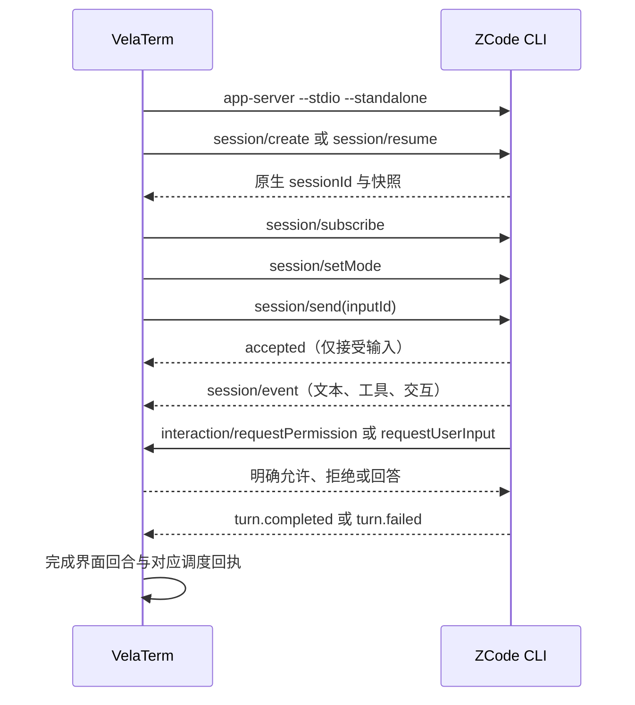

# Zcode 原生 CLI 接入

基线：VelaTerm 0.2.9。新增独立 `zcode` Harness，使用对话界面，可作为普通子智能体，以及规划、执行和审查角色参与调度。

## CLI 前置条件

此接入要求 ZCode CLI 支持 `app-server --stdio --standalone`。`--standalone` 是配套 ZCode 源码改动提供的能力：独立装配 CLI 账户注册表与运行时请求头，不依赖 ZCode 桌面 GUI。未包含该改动的官方 CLI 版本不属于已验证范围。VelaTerm PR 需要关联这项上游依赖，不能宣称现有官方发行包均可使用。

VelaTerm 不内置账户凭据或固定模型。可在智能体设置中指定 CLI 路径；未指定时依次发现 EXE 相邻的 `zcode/zcode.exe`（Unix 为 `zcode/zcode`）及通常的安装路径。运行资源由 CLI 安装提供，不向本仓库提交 Node、CLI bundle 或第三方插件二进制。

## 状态所有权与事件顺序

ZCode CLI 拥有账户、模型配置、原生会话历史、任务执行和权限判断。VelaTerm 拥有进程生命周期、树节点到原生会话 ID 的映射，以及界面投影。一个 VelaTerm Zcode 会话使用一个独立 CLI 进程。

事件按原生 `sessionId` 过滤，以 `seq` 去重。工具参数可能只出现在 `model.streaming/tool_call`，后续 `tool.updated/scheduled` 仅引用这份输入；不得因省略而清空已收到的参数。`accepted` 不能充当任务完成信号。工作流回执必须对应原始 `inputId`，重复终态不能重复提交结果。

## 账户与权限

账户菜单支持 BigModel 与 Z.AI。VelaTerm 调用原生 `login <provider> --no-browser --json`，只显示授权链接和状态；账户 JSON 不写入聊天或诊断。用户在浏览器完成授权，凭据由 CLI 自己保存。成功登录后恢复同一原生会话，使进程重新装配账户状态。

权限模式为 `plan`、`build`、`edit`、`yolo`，来源于 CLI。模式、模型与思考级别在 CLI 确认后才提交。拒绝工具应阻止其执行；停止使用 `session/stop`；停止进程后可读取原生历史，再恢复同一原生 ID。

## 验证与范围

持续验证独立子智能体入口、并发隔离、模型和思考级别、权限允许及拒绝、交互回答、中断、离线历史和恢复、调度回传、异常退出及登录取消。协议回归测试应覆盖 CLI 的真实事件形状，桌面验证通过独立配置和本地模型服务隔离个人数据。

本地模型服务通过不代表生产账户授权或线上模型服务已经验证。真实账户验证必须另行记录。当前尚未支持图片附件、即时 steer、原生 fork，以及 ZCode 桌面的浏览器与 Computer Use 宿主能力；这些操作必须明确失败。

本定制版仍连接官方更新服务。官方更新不会自动保留源码改动；与官方版共用数据目录时，应先备份数据，再验证升级和回退兼容性。
